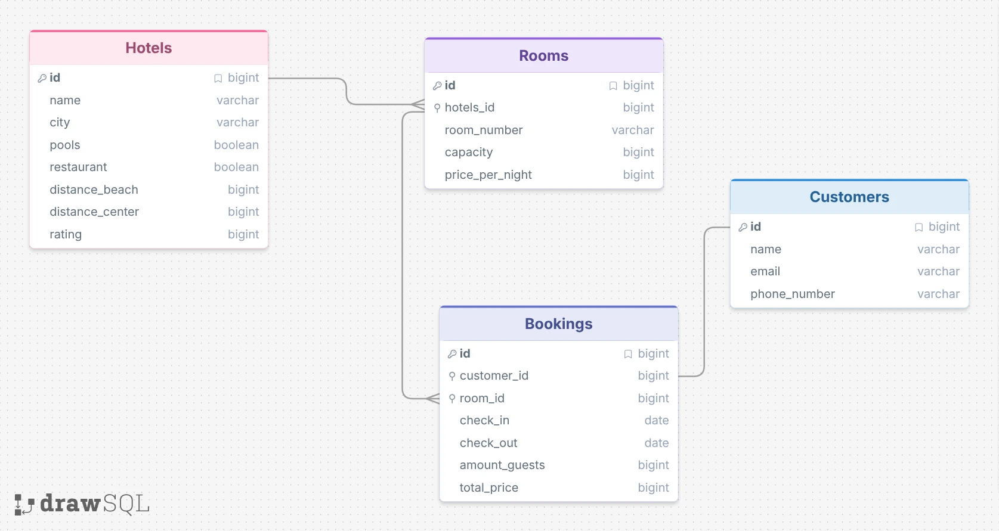

# HolidayMaker

Go to the Database folder and run the SQL script that exists in the database.sql file in your DataGrip query console to create the database and the tables. Make sure the connectionString in Program.cs matches with your local MySQL details such as password. When the database is created, you can run the program in the terminal with 'dotnet run'

